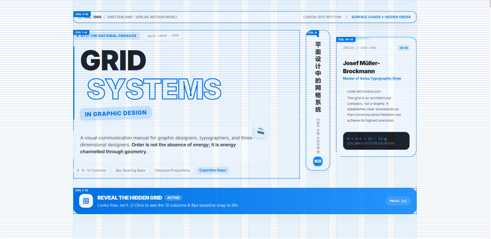

# Grid Design System — Cupertino Glass Demonstration

An Apple-inspired, Cupertino Glass web demonstration built on the principle of
**Surface chaos, hidden order** (看似自由，实则精确), inspired by
Josef Müller-Brockmann's 1968 classic *Grid Systems in Graphic Design*
(《平面设计中的网格系统》).

Companion skill: [grid-design-system](https://github.com/Jinshuooo/grid-design-system).

**Live demo:** [grid-design-system-demo.pages.dev](https://grid-design-system-demo.pages.dev/)

This demonstration showcases:
- **Cupertino Glass Aesthetic**: Frosted glass panels (`backdrop-blur-xl`),
  subtle Apple-like gray palette, vibrant system blue accents (`#0071e3`), and
  refined typography.
- **Surface Chaos × Hidden Order**: Asymmetric compositions (spans 7/5, 4/8,
  5/7, full 12) that appear loose and expressive by default, but snap strictly
  to mathematical grid tracks.
- **8px Baseline Rhythm**: Universal vertical spacing scale governing type
  leading, padding, component heights, and container gutters.
- **Unified 4 / 8 / 12-Column Canon**: 4 columns on mobile, 8 on tablet, 12 on
  desktop with zero column wrapping.
- **Live Grid Overlay Toggle**: Press `G` or click "GRID OVERLAY" to reveal
  the underlying column tracks, 8px horizontal baselines, and coordinate tags.
- **Bilingual Content (EN / ZH)**: Toggle instantly via the top bar or by
  pressing `L`.
- **Modern Frontend Stack**: Built with React 18, Vite, Tailwind CSS, and
  Lucide React. Zero external font/image CDN dependencies.

## Screenshots

| Surface chaos (grid overlay off) | Hidden order revealed (grid overlay on) |
| :---: | :---: |
|  |  |

---

## 1. Local Development

### Prerequisites

- Node.js 20+ (recommended: `.nvmrc` is included)
- npm 9+

### Install & Run

From the repository root:

```bash
# Install dependencies
npm install

# Start Vite development server
npm run dev
```

Open your browser at [http://localhost:4321](http://localhost:4321).

### Production Build & Preview

```bash
# Build production bundle to dist
npm run build

# Preview production build locally
npm run preview
```

---

## 2. Deploying to Cloudflare Pages

The demo is optimized for [Cloudflare Pages](https://pages.cloudflare.com/) with
Vite.

### Build Configuration in Cloudflare Dashboard

1. **Connect your Git repository** to Cloudflare Pages.
2. Configure project settings:
   - **Project name**: `grid-design-system-demo` (or your choice)
   - **Production branch**: `main`
   - **Framework preset**: `Vite`
   - **Root directory**: `/` (repository root)
   - **Build command**: `npm run build`
   - **Build output directory**: `dist`
3. **Environment variables**:
   - `NODE_VERSION`: `20`
4. Click **Save and Deploy**. Cloudflare Pages will install dependencies, build the
   Vite bundle, and deploy the global edge assets automatically.

---

## 3. Binding a Custom Domain

Once deployed to Cloudflare Pages:

1. In the Cloudflare Dashboard, go to your Pages project → **Custom domains**.
2. Click **Set up a custom domain**.
3. Enter your domain or subdomain (e.g., `grid.example.com` or `example.com`).
4. If your domain is on Cloudflare DNS, records will be configured automatically
   with free SSL/TLS certificates.
5. If managed by another registrar, add the provided `CNAME` pointing to your
   `*.pages.dev` target.
6. If you later bind a custom domain, update the live URL at the top of this
   README and the GitHub repository's **Website** field.

---

## 4. File Structure

```text
grid-design-system-demo/
├── index.html              # Vite entry HTML
├── package.json            # React 18, Vite 5, Tailwind 3, Lucide React
├── package-lock.json       # Reproducible dependency lockfile
├── vite.config.js          # Vite configuration (dev port 4321)
├── tailwind.config.js      # Cupertino Glass theme & 8px spacing tokens
├── postcss.config.js       # PostCSS with Tailwind & Autoprefixer
├── .nvmrc                  # Node 20
├── .gitignore              # node_modules, dist, local state
├── LICENSE                 # MIT
├── images/
│   ├── demo-en-surface.png # Surface chaos screenshot
│   └── demo-en-grid.png    # Hidden grid screenshot
├── public/
│   └── favicon.svg         # Geometric vector brand icon
├── src/
│   ├── main.jsx            # React root with Inter font imports
│   ├── App.jsx             # Main application layout & keyboard shortcuts
│   ├── index.css           # Tailwind base, baseline grid, & glass utilities
│   ├── context/
│   │   └── LanguageContext.jsx # Bilingual state & localStorage persistence
│   └── components/
│       ├── Header.jsx      # Sticky Cupertino glass control bar
│       ├── GridOverlay.jsx # Responsive 4/8/12-column overlay & baseline
│       ├── Hero.jsx        # Surface chaos poster hero & reveal CTA
│       ├── Marquee.jsx     # Kinetic typography ribbon
│       ├── TheBook.jsx     # Section 01: The Book & Digital Relevance
│       ├── Principles.jsx  # Section 02: Four Foundational Principles
│       ├── FieldSystems.jsx# Section 03: 8 / 20 / 32 Modular Field Diagrams
│       ├── PageAnatomy.jsx # Section 04: Classical 2:3:4:6 Spread Anatomy
│       ├── Specimen.jsx    # Section 05: 8px Baseline & Type Scale
│       ├── FAQ.jsx         # Section 06: 7 Bilingual Accessible FAQs
│       ├── Disclaimer.jsx  # Section 07: Legal Notice & Non-Infringement
│       └── Footer.jsx      # Specifications, credits, & back-to-top
└── README.md               # This deployment guide
```

---

## 5. Non-Infringement Notice

This demonstration is an independent, non-commercial educational project. It
does not reproduce the copyrighted cover artwork, photographic reproductions,
or text passages of the original 1968 publication or its translations. All
layouts, color schemes, CSS diagrams, and explanatory texts are original
creations inspired by Swiss graphic design theory.
